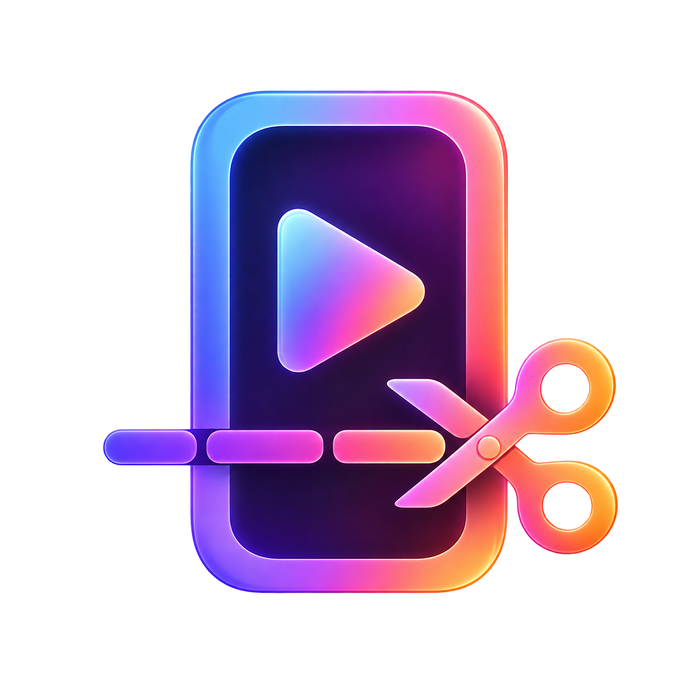

<p align="center"></p>

# Shortigo

**Polska aplikacja desktopowa, która zamienia długie filmy w krótkie klipy z napisami.**
Automatycznie wybiera fragmenty, kadruje i renderuje; gotowe klipy można poprawić w aplikacji.

Shortigo jest niezależnym rozwinięciem [BridgeClip](https://github.com/bridge-mind/bridgeclip) autorstwa BridgeMind, na licencji MIT. Nie jest oficjalnym wydaniem BridgeMind.

> Obecnie udostępniamy kod źródłowy i uruchomienie lokalne. Repozytorium nie zawiera gotowego, podpisanego instalatora. Głównym środowiskiem rozwoju jest macOS Apple Silicon; Windows i Linux nie zostały zweryfikowane w tej wersji.

## Funkcje

- Film z dysku lub link do wideo; transkrypcja i wybór fragmentów przez OpenRouter.
- Automatyczne kadrowanie, polskie napisy, gotowe style napisów i tytułów.
- Opcjonalne usuwanie zawahań (`yyy`, `eee`) i mocniejszy początek klipu.
- Biblioteka, ulubione, foldery z nazwami filmów i usuwanie plików z aplikacji.
- Montaż po wygenerowaniu: podgląd, podział i przycinanie, grafiki, dodatkowe fragmenty, tytuł i muzyka. Eksport montażu tworzy nową wersję.
- Miniaturki z wybranego kadru przez modele obrazowe OpenRouter — uruchamiane ręcznie, z wyborem modelu i promptu.
- Publikowanie i planowanie przez Zernio, osobne opisy YouTube i TikToka oraz oznaczanie wysłanych klipów.
- Kopiowanie klipów do folderu synchronizowanego przez Dysk Google.

## Instalacja na macOS

Wymagania: **Node.js 22, Python 3.12, Git i FFmpeg z filtrem `ass` (libass)**.
Przykład z [Homebrew](https://brew.sh):

```bash
brew install node@22 python@3.12 ffmpeg-full
export PATH="$(brew --prefix node@22)/bin:$(brew --prefix ffmpeg-full)/bin:$PATH"

git clone https://github.com/szerlok/shortigo.git
cd shortigo
python3.12 -m venv engine/.venv
engine/.venv/bin/python -m pip install --require-hashes -r engine/requirements.lock
npm ci
npm run dev
```

Polecenie `export PATH=...` należy wykonać również w nowym terminalu przed uruchomieniem aplikacji, jeśli te narzędzia nie są już w PATH.

W **Ustawieniach** dodaj własny klucz [OpenRouter](https://openrouter.ai/keys) i uruchom sprawdzenie narzędzi. Jeśli Python nie zostanie wykryty, wskaż pełną ścieżkę do `engine/.venv/bin/python` w sklonowanym repozytorium. Silnik i jego zasoby są częścią projektu; nie trzeba klonować dodatkowego repozytorium.

```bash
# Kolejne uruchomienia z folderu projektu:
npm run dev

# Uruchomienie zbudowanej wersji:
npm run build
npm run preview
```

Zakończenie polecenia w terminalu zamyka aplikację uruchomioną w ten sposób. Na macOS **⌘Q** kończy działanie całej aplikacji; samo zamknięcie okna może pozostawić ją w tle.

## Pierwszy klip

1. Dodaj klucz OpenRouter i wybierz folder wynikowy w ustawieniach.
2. W **Utwórz** wybierz film albo wklej link, ustaw długości i wygląd klipów.
3. Uruchom generowanie; wyniki pojawią się w **Bibliotece**.
4. Obejrzyj klip, wprowadź poprawki w montażu lub wygeneruj miniaturkę.
5. Zapisz plik albo połącz własne konto Zernio i wybierz odbiorców publikacji.

W wersji publicznej opisy nie zawierają automatycznie reklam ani hashtagów konkretnej marki. Każda platforma zachowuje wpisany przez Ciebie tekst.

### Muzyka

Dodaj własne pliki WAV, MP3, M4A lub FLAC do [music/](music/README.md), a potem włącz muzykę w formularzu tworzenia. Utwory są wybierane losowo; wybór można później zmienić w montażu.

Muzyka jest domyślnie **wyłączona**, ponieważ repozytorium nie zawiera licencjonowanych utworów użytkownika. Korzystaj z materiałów, na które masz odpowiednie prawa. Pliki muzyczne są ignorowane przez Git.

### Dysk Google

Zainstaluj aplikację Dysk Google na komputerze i skonfiguruj synchronizację folderu `~/BridgeClip/shortigo`. Utwórz ten folder przed pierwszym eksportem. Przycisk przesyłania kopiuje klip do podfolderu nazwanego jego tytułem, zachowując oryginał w bibliotece. **Synchronizację wykonuje aplikacja Google Drive**, a nie Shortigo; pojawienie się kopii lokalnej nie potwierdza jeszcze przesłania do chmury.

### Zernio i koszty

Zernio jest opcjonalne — lokalne tworzenie i eksport działają bez niego. Publikacja wymaga własnego klucza i połączonych kont. OpenRouter oraz Zernio mogą naliczać opłaty według swoich cenników. Renderowanie, cięcia i miksowanie muzyki odbywają się lokalnie.

Na niektórych połączeniach sieciowych obserwowano przerywanie dużych transferów do magazynu Zernio (`EPIPE`, błędy TLS). Dostępne są ponowienia i ograniczenie prędkości, ale nie gwarantują rozwiązania. Porównaj wysyłkę tego samego klipu w innej sieci; alternatywą pozostaje lokalny eksport lub folder Dysku Google.

## Prywatność

- Każdy użytkownik podaje własne klucze w aplikacji. Są przechowywane lokalnie przy użyciu bezpiecznego magazynu systemu; repozytorium ich nie zawiera.
- Audio do transkrypcji i tekst do planowania są wysyłane do OpenRouter. Niektóre opcje analizy obrazu przesyłają także kadry; generowanie miniaturki przesyła wybrany kadr i prompt.
- Publikacja wysyła wybrany film, opisy i opcje do Zernio oraz jego magazynu plików.
- Wyniki domyślnie trafiają do `~/BridgeClip`. Mogą zawierać transkrypcję, źródło do montażu i wcześniejsze eksporty, co zajmuje dodatkowe miejsce.
- Publiczna wersja używa oddzielnego folderu ustawień `Shortigo` w katalogu danych aplikacji. Nie importuje automatycznie kluczy z prywatnej instalacji BridgeClip.
- Usuwanie klipów i zadań w bibliotece może usuwać rzeczywiste pliki z dysku. Usunięcie lokalnej kopii nie usuwa wcześniejszych publikacji w sieci.

## Rozwój

```bash
npm run typecheck
npm run lint
npm test
npm run build
```

Testy Pythona: `PYTHONPATH=engine engine/.venv/bin/python -m unittest discover -s bridge`.
Testy silnika wymagają dodatkowo `pytest`: `PYTHONPATH=engine engine/.venv/bin/python -m pytest engine/tests`.
Testy integracyjne z Electronem: `npm run test:e2e`. Używają lokalnych atrap usług, nie prawdziwych kont społecznościowych.

Kod: `src/main` (Electron), `src/renderer` (React), `src/shared` (kontrakty), `bridge` (procesy Pythona), `engine` (analiza i renderowanie).
Wskazówki: [CONTRIBUTING.md](CONTRIBUTING.md), [architektura](docs/ARCHITECTURE.md), [wydania](docs/RELEASING.md).
Starsze dokumenty przeglądów w `docs/` pochodzą z BridgeClip i opisują stan projektu bazowego, nie certyfikację wszystkich rozszerzeń Shortigo.

## Licencja i autorstwo

Kod jest udostępniony na [licencji MIT](LICENSE). Oryginalny BridgeClip i silnik: **BridgeMind**; rozwinięcie Shortigo: [szerlok](https://github.com/szerlok) i współtwórcy. Zachowano oryginalne informacje o prawach autorskich. Czcionki, modele i zależności zachowują odrębne licencje opisane w [THIRD_PARTY_NOTICES.md](THIRD_PARTY_NOTICES.md) i [engine/THIRD_PARTY_NOTICES.md](engine/THIRD_PARTY_NOTICES.md).

English: Shortigo is a Polish-language desktop video clipping and editing app, independently derived from BridgeClip. It runs locally, requires your own provider keys, and currently ships as source code. See the macOS setup commands above.
